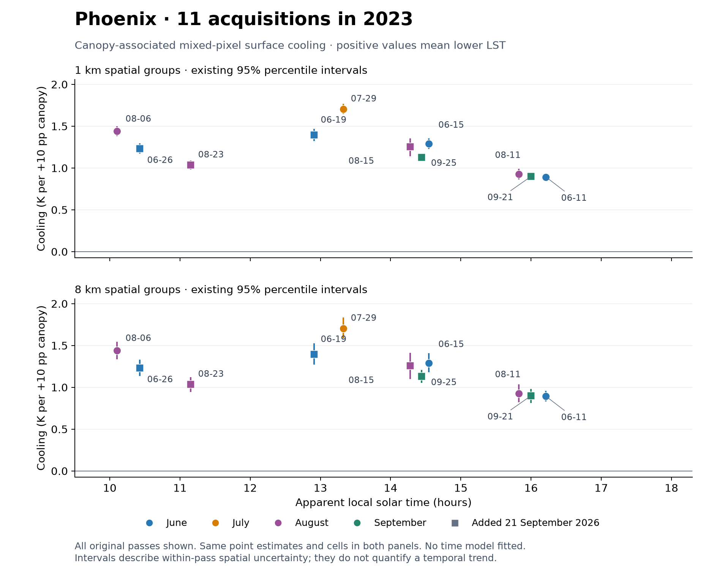
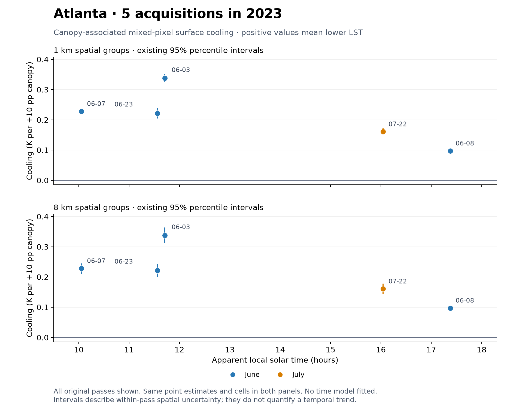

# Task 1. Assemble existing results

**Status: completed for the sixteen-pass 2023 pilot.**

## Deliverables requested

| Deliverable | File or review page | Status |
| --- | --- | --- |
| D1. Scope and estimator record | [Scope and model](scope_and_model.md) | Available |
| D2. One CSV for all sixteen original passes | [Results with conditions](pass_results_with_conditions.csv) | Available, source joins documented |
| D3. Separate city plots with dates and intervals | [Phoenix](figures/phoenix_cooling_vs_solar_time.png), [Atlanta](figures/atlanta_cooling_vs_solar_time.png) | Available |
| D4. Findings and missing-input summary | [Task summary](#task-1-assemble-existing-results), [new findings](../CHANGES_SINCE_SEPTEMBER.md) | Available, geometry limits retained |

Start with the [combined sixteen-pass table](pass_results_with_conditions.csv). It joins existing released results, support, weather and geometry records by city and orbit. The original model, sample and controls are unchanged. The only added numerical transformation is the documented sign/unit conversion from temperature change per +10pp to slope per unit canopy fraction.

There are eleven Phoenix and five Atlanta original observations, all from 2023. No other-year fit enters this table. Phoenix cooling ranges from 0.893 to 1.705 K per +10pp canopy, and Atlanta from 0.097 to 0.338. All individual existing 8 km spatial intervals are above zero. These are conditional mixed-pixel associations.

## Cooling versus observation time

### Phoenix

### Atlanta

The figure legends identify the 1 km and 8 km interval panels. Different dates supply different observation times. Neither plot establishes a same-day trajectory or a causal city ranking.

## Table interpretation

Use `apparent_solar_hour` as the documented current pass-time field, matching the released acquisition table. Older `solar_hour` and inherited time fields remain as source provenance and do not define a second comparison schedule.

- Positive `cooling_K_per_10pp` means lower temperature with higher canopy. `gradient_K_per_10pp` retains the signed temperature change. `temperature_slope_K_per_canopy_fraction` equals that gradient divided by 0.10.
- The named 1/2/4/8 km SE and interval fields retain the original spatial sensitivities. Diagnostic fields ending `_8km` come from the released paired-scale summary and are labelled separately from the original temperature intervals.
- Rainfall fields identify the hour-ended product for each window. One entire seven-day window uses Stage IV while its primary MRMS value remains missing in the source ledger.
- Geometry coverage describes the archived domain population. Modeled-cell coverage and incomplete azimuth remain explicit.

The [unchanged original table](supporting_tables/original_pass_results.csv), [released compact summary](supporting_tables/released_pass_summary.csv) and [all spatial-group results](supporting_tables/all_spatial_group_sensitivities.csv) are retained for source reconciliation. The [dictionary](supporting_tables/released_data_dictionary.md) explains the released scientific fields.
