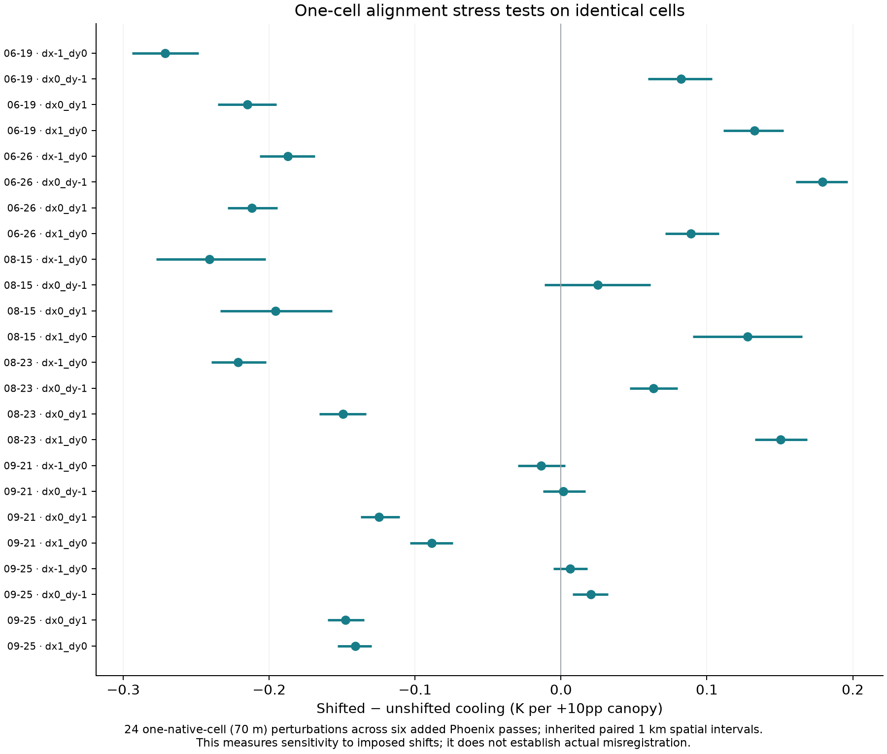

# Task 2. Assess spatial robustness

**Status: completed effect review, with substantive limitations retained.**

## Deliverables requested

| Deliverable | File or review page | Status |
| --- | --- | --- |
| D1. Common-cell comparison, map and composition | [Effect figure](figures/common_footprint_review.png), [map](figures/common_footprint_predictor_map.png), [table](tables/common_footprint_comparisons.csv) | Available |
| D2. Fixed-support registration differences | [Figure](figures/registration_review.png), [paired table](tables/fixed_registration_comparisons.csv) | Available for the recorded tests |
| D3. Separate available-support shifts | [Point table](tables/available_registration_points.csv) | Available, paired intervals not established |
| D4. Paired scales and reference sensitivity | [Figure](figures/paired_pass_review.png), [paired table](tables/paired_scale_diagnostics.csv), [references](tables/reference_sensitivity.csv) | Available, no practical agreement verdict |
| D5. Spatial precision, residuals and information concentration | [Precision](supporting_tables/spatial_precision_review.csv), [residuals](supporting_tables/inherited_residual_spatial_diagnostics.csv), [pass support](../01_existing_results/supporting_tables/original_pass_results.csv) | Available |

## Common footprint

The common Phoenix footprint contains 196,090 native cells and retains 35–57% of each original pass. All eleven common-footprint cooling estimates are lower than their original-population estimates, by 0.095–0.376 K/+10pp. Each individual paired 8 km change interval excludes zero. The common sample changes the represented geography and context, so it remains a population sensitivity.

See the [comparison table](tables/common_footprint_comparisons.csv), [retention figure](figures/common_footprint_retention.png), [footprint map](figures/common_footprint_predictor_map.png), and [canopy/context distributions](supporting_tables/canopy_context_distributions.csv).

## Fixed-support registration

The 24 imposed one-cell shifts on identical cells change cooling by −0.271 to +0.179 K/+10pp. Twenty individual paired 1 km intervals exclude zero. These are deliberate 70 m stress tests and do not establish the actual registration error. The [fixed-support table](tables/fixed_registration_comparisons.csv) remains separate from [44 available-support points](tables/available_registration_points.csv), which also change populations and lack established paired difference intervals.

## Paired temperature and energy diagnostics

Temperature stays primary. Emitted flux and its fixed-reference equivalent derive from the same retrievals. Their numerical differences and [reference sensitivity](tables/reference_sensitivity.csv) can be reviewed now, while practical agreement remains undecided without a numerical margin. See [paired pass results](tables/paired_scale_diagnostics.csv) and the [window-scale diagnostic](figures/temperature_energy_review.png).

The [spatial precision table](supporting_tables/spatial_precision_review.csv) and [inherited residual diagnostics](supporting_tables/inherited_residual_spatial_diagnostics.csv) retain the uncertainty evidence. The 8 km grouping does not prove independence. Exploratory individual intervals are unadjusted for multiple comparisons.
