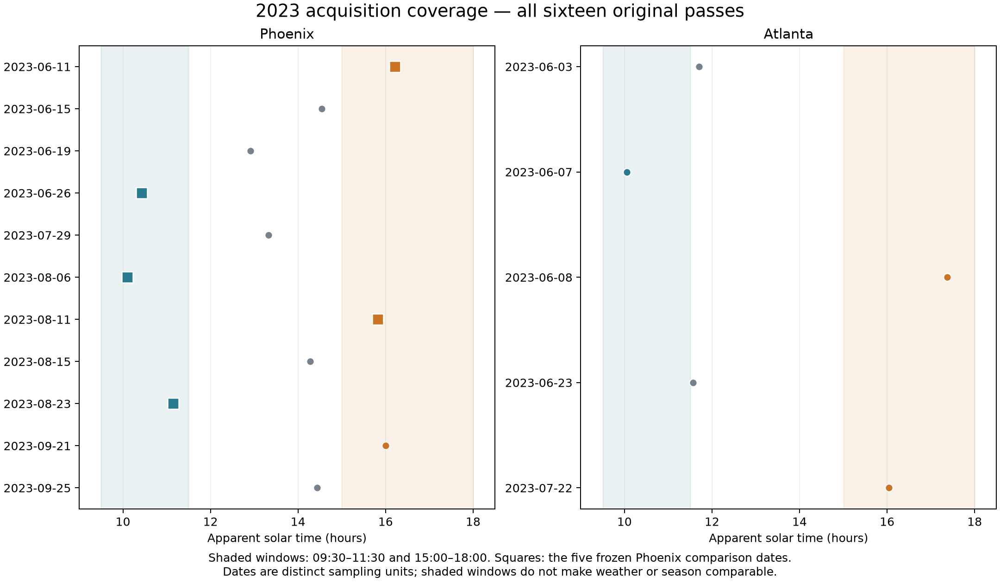

# Task 3. Evaluate observation-time differences

**Status: the fixed-date Phoenix comparison and actual-design calibration are complete. A general summer time effect remains unsupported.**

## Deliverables requested

| Deliverable | File or review page | Status |
| --- | --- | --- |
| D1. Weighted and monthly comparisons | [Comparison figure](figures/phoenix_time_comparison.png), [result table](tables/phoenix_window_comparisons.csv) | Available for frozen dates |
| D2. Date/time, weather, footprint and geometry diagnostics | [Conditions](tables/conditions_with_rainfall.csv), [geometry](tables/geometry_support.csv), [schedule](supporting_tables/comparison_schedule.csv) | Available with declared geometry limits |
| D3. Influence and unsupported deletions | [Deletion figure](figures/monthly_and_supported_date_deletions_8km.png), [schedule audit](supporting_tables/leave_one_date_schedule.json) | Two deletions supported, three unsupported |
| D4. Fixed-date joint spatial uncertainty | [Matched sensitivity intervals](tables/joint_window_sensitivities.csv) | Available, failed common draws retained |
| D5. Actual-design time-uncertainty calibration | [Synthetic report](synthetic_calibration/README.md) | Completed, broader summer interval not adopted |

The primary fixed-date comparison uses half-weight June and August within each arm. Morning is 09:30–11:30 and afternoon is 15:00–18:00 apparent solar time. June 11 and August 11 supply afternoons. June 26, August 6 and August 23 supply mornings.

| Original linear comparison | Afternoon minus morning cooling (K/+10pp) | Original Step 7 95% spatial interval, 8 km |
| --- | ---: | --- |
| June + August | −0.325 | [−0.391, −0.262] |
| June | −0.339 | [−0.412, −0.271] |
| August | −0.311 | [−0.396, −0.228] |
| Omit August 6 | −0.224 | [−0.285, −0.164] |
| Omit August 23 | −0.426 | [−0.500, −0.359] |

Both arms indicate cooling. The weighted morning estimate is 1.235 K/+10pp and the afternoon estimate is 0.910. The negative difference means weaker cooling association on these afternoon dates. Removing June 11, June 26 or August 11 empties a required month/arm and is unsupported.

The [original comparison table](tables/phoenix_window_comparisons.csv) and [monthly/date-deletion plot](figures/monthly_and_supported_date_deletions_8km.png) preserve these results. The [post-disclosure matched sensitivity table](tables/joint_window_sensitivities.csv) gives −0.325, −0.106 and −0.433 for original-linear, common-linear and original-quadratic variants. Its fresh original interval is [−0.385, −0.262], with the old interval above retained separately. Four coarse joint common-footprint draws fail due to absent sampled bare-cover variation, without replacement.

## Conditions and uncertainty limits

Weather covers all sixteen acquisitions. [Conditions](tables/conditions_with_rainfall.csv), [geometry status](tables/geometry_support.csv), [schedule](supporting_tables/comparison_schedule.csv) and [rainfall ledger](supporting_tables/rainfall_source_gaps.json) preserve identities and missingness. June 26 morning air temperature is about 5.6°C warmer than June 11 afternoon, and winds/rainfall differ. Geometry azimuth and modeled-cell coverage remain incomplete.

The spatial intervals condition on the dates and represented populations. They do not provide independent-day replication. No empirical Atlanta time contrast is adopted. See the separately labelled [synthetic calibration](synthetic_calibration/README.md) for why a broader summer interval was not adopted.
