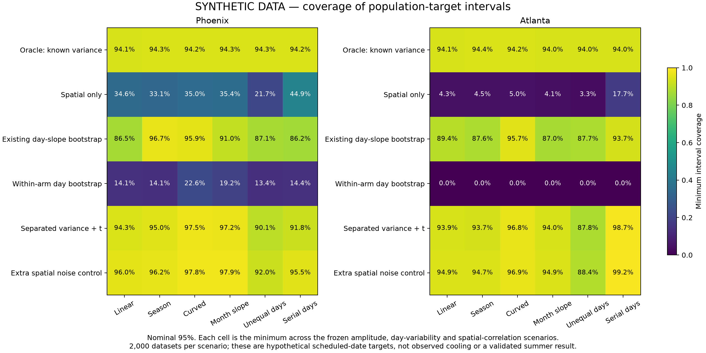

# Synthetic uncertainty calibration

These files describe **216 scenarios × 2,000 generated datasets = 432,000 synthetic datasets**, using the actual schedules and estimated spatial covariance with declared hypothetical mean/day processes. They are not observed cooling effects or empirical confirmation.

| Nominal 95% population-target interval | Phoenix coverage range | Atlanta coverage range |
| --- | --- | --- |
| Existing day-slope bootstrap | 86.2–100% | 87.0–100% |
| Candidate separating spatial/day variance | 90.15–100% | 87.8–100% |
| Dates resampled within month/arms | 13.4–81.8% | 0% |
| Oracle given true simulated variance | 94.1–96.55% | 94.0–96.3% |

The mean amplitudes and day variances are simulation assumptions. Neither the existing method nor the candidate established adequate coverage across the tested scenarios. No empirical general-summer interval was adopted. The oracle has information unavailable in the real study.

The [production results](SYNTHETIC_DATA_production_calibration.csv), [known targets](SYNTHETIC_DATA_production_truth.csv), [draw/support audit](SYNTHETIC_DATA_production_bank_audit.json) and [month/arm support](SYNTHETIC_DATA_month_arm_support.json) preserve the detailed assessment.
