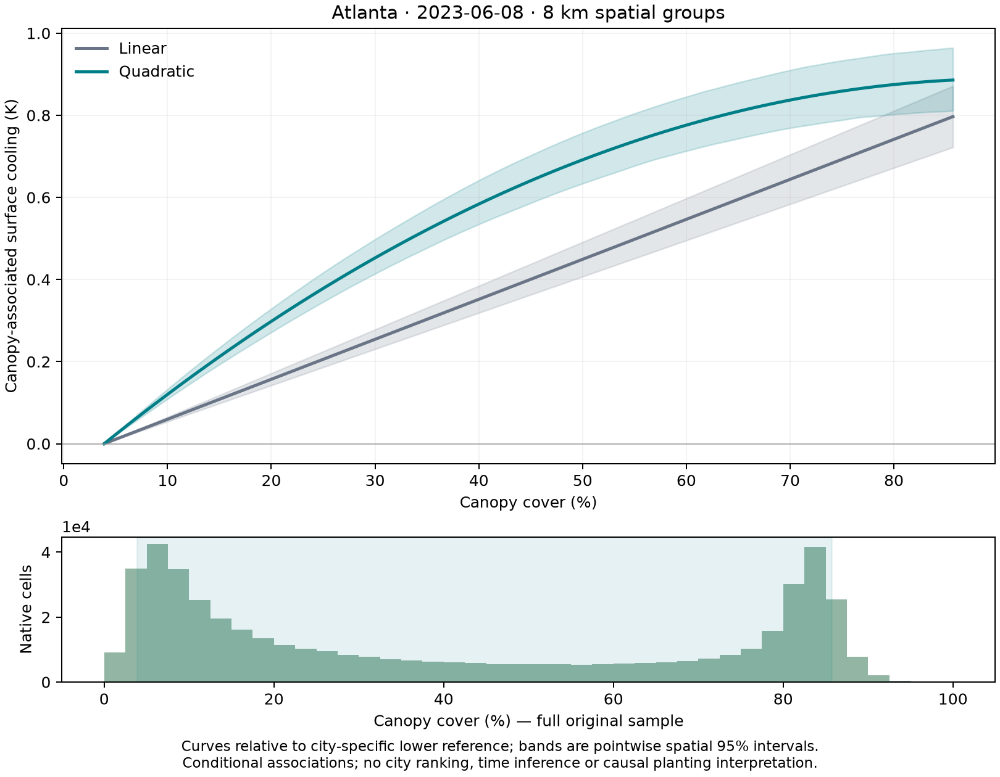

# Task 4. Assess canopy response nonlinearity

**Status: all sixteen paired quadratic fits and 32,000 matched spatial resamples completed, and the effects and curves were reviewed.** This is Task 4 in Alizadeh's document and Step 5 in the historical execution plan.

## Deliverables requested

| Deliverable | File or review page | Status |
| --- | --- | --- |
| D1. Linear/quadratic curves with canopy support | [All sixteen curve plots](#all-sixteen-pass-specific-curves) | Available |
| D2. Linear and quadratic finite contrasts | [Comparison figure](figures/quadratic_model_review.png), [historical table](tables/quadratic_historical_contrasts.csv), [all candidates](tables/quadratic_all_finite_contrasts.csv) | Available |
| D3. Endpoint and covariate support by city | [Support figure](figures/historical_endpoint_support.png), [counts](supporting_tables/endpoint_support.csv), [covariates](supporting_tables/endpoint_covariate_profiles.csv) | Available, conditional overlap remains limited |
| D4. Correct prediction and matched resampling implementation | [Code](../../../src/v6_2_advance/quadratic_sensitivity.py), [known-answer tests](../../../tests/v6_2_advance/test_quadratic_sensitivity.py) | Implemented and checked in the completed run |

## Start with an actual curve

The teal curve is quadratic and the grey line is linear. Shading shows per-pass pointwise spatial 95% intervals. The histogram shows the full original sample's canopy distribution. Curves use city-specific lower references, so endpoints cannot be read as a city-efficiency ranking.

## Finite-contrast results

At the unchanged historical endpoints, approximately 2.85% and 12.85% canopy, quadratic-minus-linear cooling changes range from −0.059 to +0.092 K/+10pp in Phoenix and −0.014 to +0.097 in Atlanta. Six of eleven Phoenix and four of five Atlanta individual paired 8 km intervals exclude zero. These exploratory comparisons are unadjusted for multiplicity. Atlanta June 8 changes from 0.097 K under the linear model to 0.195 K under the quadratic model.

Use the [historical-endpoint table](tables/quadratic_historical_contrasts.csv), [all candidate finite contrasts](tables/quadratic_all_finite_contrasts.csv) and [all curve points](tables/quadratic_all_curves.csv). The linear model remains primary and no curve was selected by significance.

## Support and implementation

Only about 2.0–2.5% of Phoenix cells fall within ±1pp of the upper historical endpoint, compared with 23.7–24.9% near the lower endpoint. Full rank and block ranges do not establish conditional overlap. All original cells and six controls remain in the fits. See [endpoint counts](supporting_tables/endpoint_support.csv), [covariate profiles](supporting_tables/endpoint_covariate_profiles.csv), [context-distance diagnostics](supporting_tables/cross_city_context_distances.csv) and [candidate pair support](figures/candidate_pair_block_support.png).

The model squares raw canopy before centering each term within blocks. Every prediction and matched bootstrap contrast updates both canopy terms. The known-answer 10%–20% cooling contrast for `T = 305 − 5f + 2f²` is 0.44 K. All sixteen original linear estimates were recovered.

Code: [quadratic implementation](../../../src/v6_2_advance/quadratic_sensitivity.py), [runner](../../../src/v6_2_advance/run_quadratic_sensitivity.py), [known-answer tests](../../../tests/v6_2_advance/test_quadratic_sensitivity.py).

## All sixteen pass-specific curves

| City | Date | Orbit and curve plot |
| --- | --- | --- |
| Atlanta | 2023-06-03 | [27835](curves/Atlanta_2023-06-03_linear_vs_quadratic_8km.png) |
| Atlanta | 2023-06-07 | [27896](curves/Atlanta_2023-06-07_linear_vs_quadratic_8km.png) |
| Atlanta | 2023-06-08 | [27916](curves/Atlanta_2023-06-08_linear_vs_quadratic_8km.png) |
| Atlanta | 2023-06-23 | [28145](curves/Atlanta_2023-06-23_linear_vs_quadratic_8km.png) |
| Atlanta | 2023-07-22 | [28598](curves/Atlanta_2023-07-22_linear_vs_quadratic_8km.png) |
| Phoenix | 2023-06-11 | [27963](curves/Phoenix_2023-06-11_linear_vs_quadratic_8km.png) |
| Phoenix | 2023-06-15 | [28024](curves/Phoenix_2023-06-15_linear_vs_quadratic_8km.png) |
| Phoenix | 2023-06-19 | [28085](curves/Phoenix_2023-06-19_linear_vs_quadratic_8km.png) |
| Phoenix | 2023-06-26 | [28192](curves/Phoenix_2023-06-26_linear_vs_quadratic_8km.png) |
| Phoenix | 2023-07-29 | [28706](curves/Phoenix_2023-07-29_linear_vs_quadratic_8km.png) |
| Phoenix | 2023-08-06 | [28828](curves/Phoenix_2023-08-06_linear_vs_quadratic_8km.png) |
| Phoenix | 2023-08-11 | [28909](curves/Phoenix_2023-08-11_linear_vs_quadratic_8km.png) |
| Phoenix | 2023-08-15 | [28970](curves/Phoenix_2023-08-15_linear_vs_quadratic_8km.png) |
| Phoenix | 2023-08-23 | [29092](curves/Phoenix_2023-08-23_linear_vs_quadratic_8km.png) |
| Phoenix | 2023-09-21 | [29545](curves/Phoenix_2023-09-21_linear_vs_quadratic_8km.png) |
| Phoenix | 2023-09-25 | [29606](curves/Phoenix_2023-09-25_linear_vs_quadratic_8km.png) |
