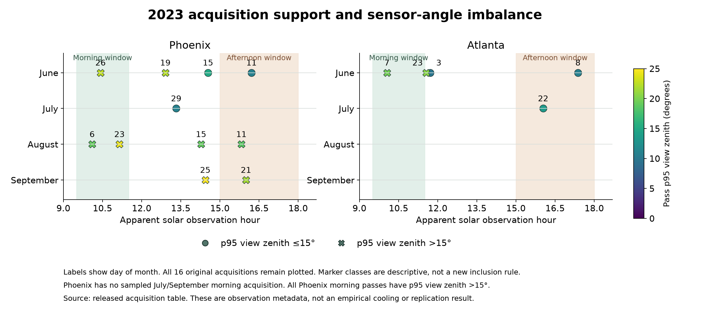
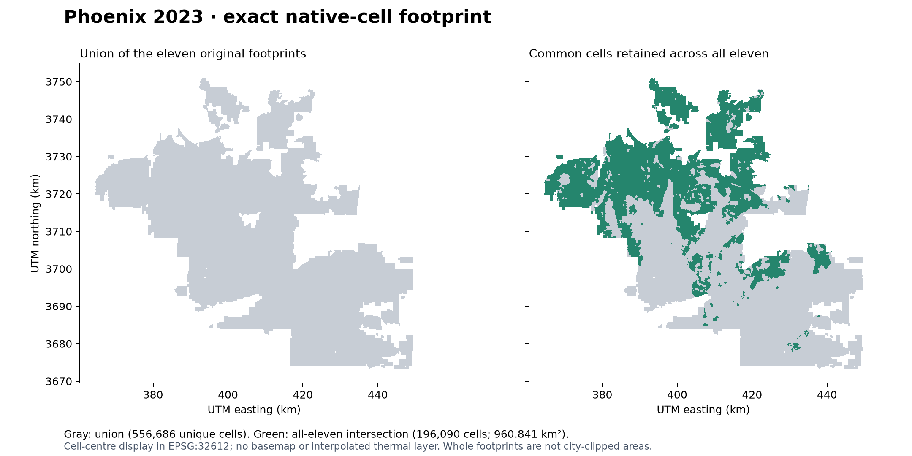
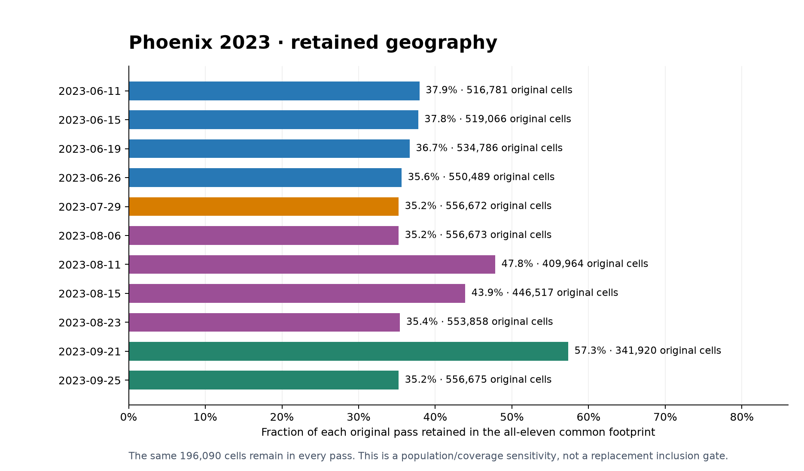

# Figure 1. Sample and support

**Required:** city maps, usable/shared footprints, dates by month and solar time, missing windows and sensor-angle imbalance.

**Available:** Phoenix shared-footprint map, pass retention, the two-city date/time/view-angle plot and exact geometry ledger. **Remaining gap:** the final two-city map showing each city's actual modeled usable footprints is not assembled. The Phoenix shared map is not an Atlanta map or proof of complete modeled-cell geometry coverage.

## 1A. Dates, missing windows and sensor angles

All sixteen original 2023 acquisitions are shown. Colour gives pass p95 view zenith. Circles and crosses distinguish the historical 15° reference descriptively, without excluding any pass. The three Phoenix observations at or below 15° provide no morning counterpart. [Schedule data](dates_by_month_and_time_window.csv), [geometry ledger](geometry_support.csv), [plotting code](plot_released_acquisition_metadata.py).

## 1B. Phoenix shared footprint and context

## 1C. Retained area in each original Phoenix pass

The common footprint retains 35–57% of original pass cells. Its population differs from the original samples. Source maps and retention plots are unchanged copies of the released evidence. The date/view plot is a new display of released metadata, with no thermal raster access or model fit.
