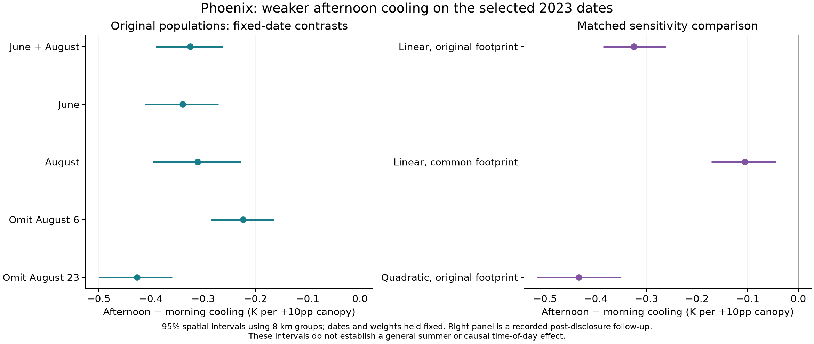
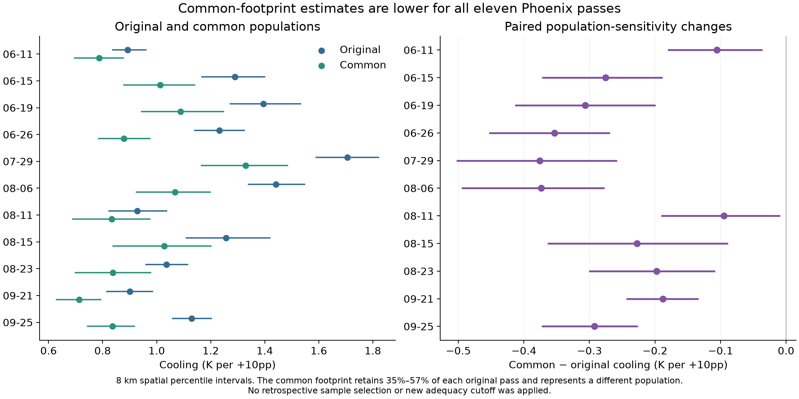
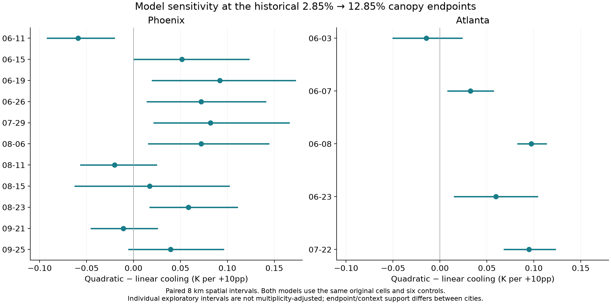
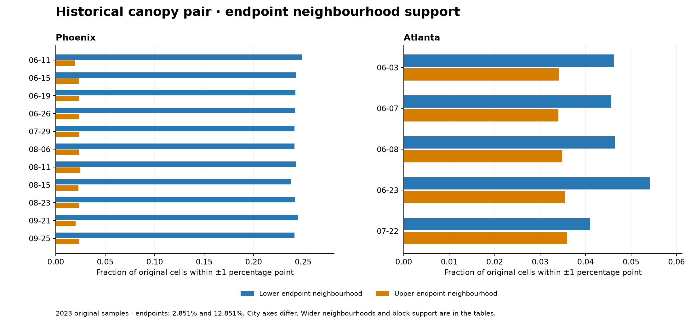
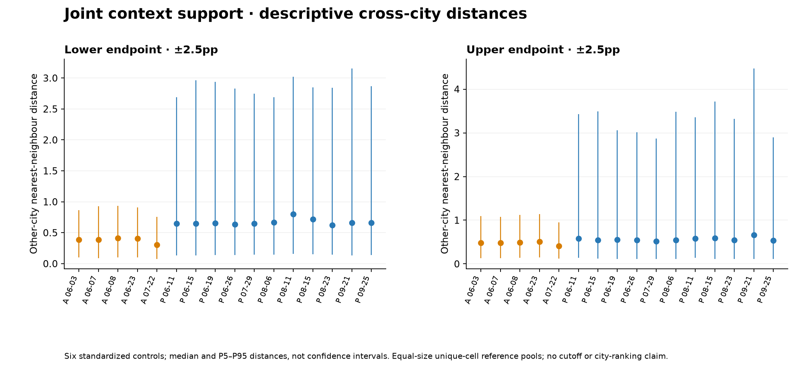

# Figure 3. Robustness of the conclusion

**Required:** show how the same comparison changes under common spatial support, fixed-support registration and common canopy support, with population changes labelled.

**Available:** matched fixed-date original/common/quadratic contrasts, per-pass paired footprint changes, fixed-support registration stress tests and endpoint/context-support diagnostics. **Remaining limits:** a joint fixed-support-registration interval for the whole five-date window is not established here. Conditional canopy/context overlap does not support a causal city ranking. These distinct checks should not be presented as interchangeable versions of a single population target.

## 3A. The same frozen window weights across population/model variants

## 3B. Common-footprint pass changes

## 3C. Fixed-support registration, assessed per pass

## 3D. Fixed-endpoint quadratic changes

## 3E. Canopy endpoints and context support

Common-footprint analysis changes the population. Fixed-support shifts hold cells constant within each tested pass. Quadratic contrasts use the original samples and unchanged endpoints. No cutoff, reference or model was selected to obtain a preferred result. [Spatial results](../../02_spatial_robustness/README.md), [quadratic results](../../04_canopy_nonlinearity/README.md).
