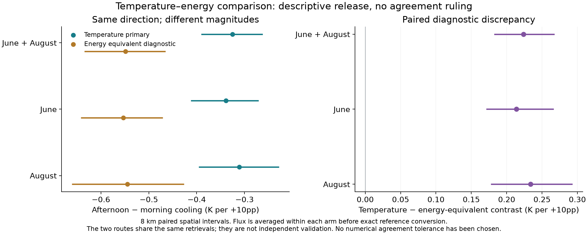
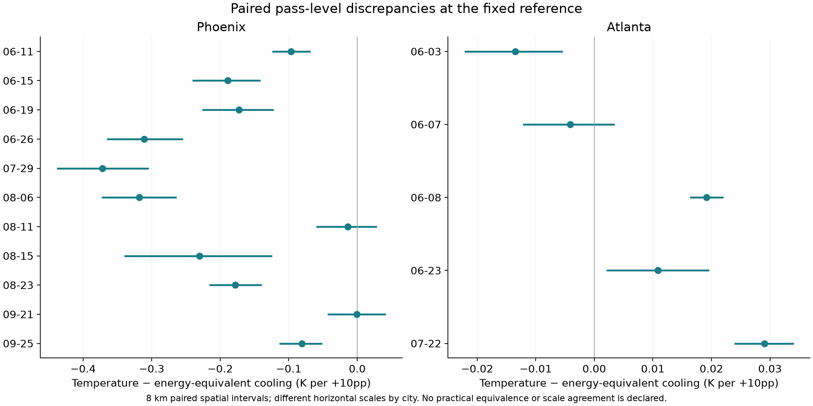

# Figure 4. Interpretation and replication

**Required:** paired temperature/flux diagnostic and independent supported replication, if available. Synthetic results must not be presented as empirical confirmation.

**Available:** the paired original-window and pass-level diagnostics. **Independent supported replication is not available.** The current sixteen-pass pilot and its sensitivity variants are the same exploratory study.

## 4A. Paired window diagnostic

The original five-date temperature contrast is −0.325 K/+10pp and the fixed-reference energy equivalent is −0.549. Their paired difference is +0.224 with 8 km interval [+0.182, +0.268]. Temperature remains primary. These routes use the same retrievals and are not independent validation.

## 4B. Paired pass diagnostics

A formal practical agreement ruling needs a numerical margin that acknowledges prior disclosure. [Diagnostic table](../../02_spatial_robustness/tables/paired_scale_diagnostics.csv), [reference sensitivity](../../02_spatial_robustness/tables/reference_sensitivity.csv).

The [synthetic calibration](../../03_observation_time/synthetic_calibration/README.md) belongs to the uncertainty assessment and is not an empirical replication panel.
