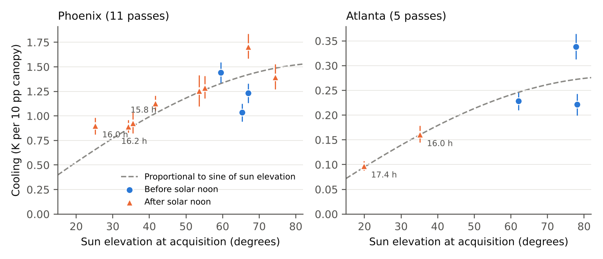
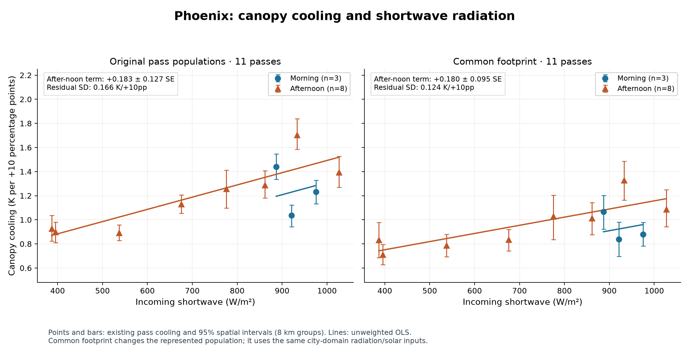
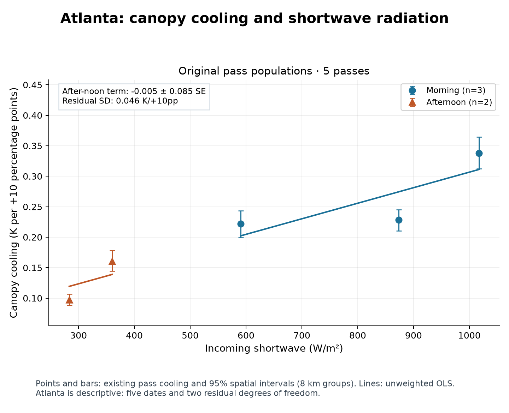
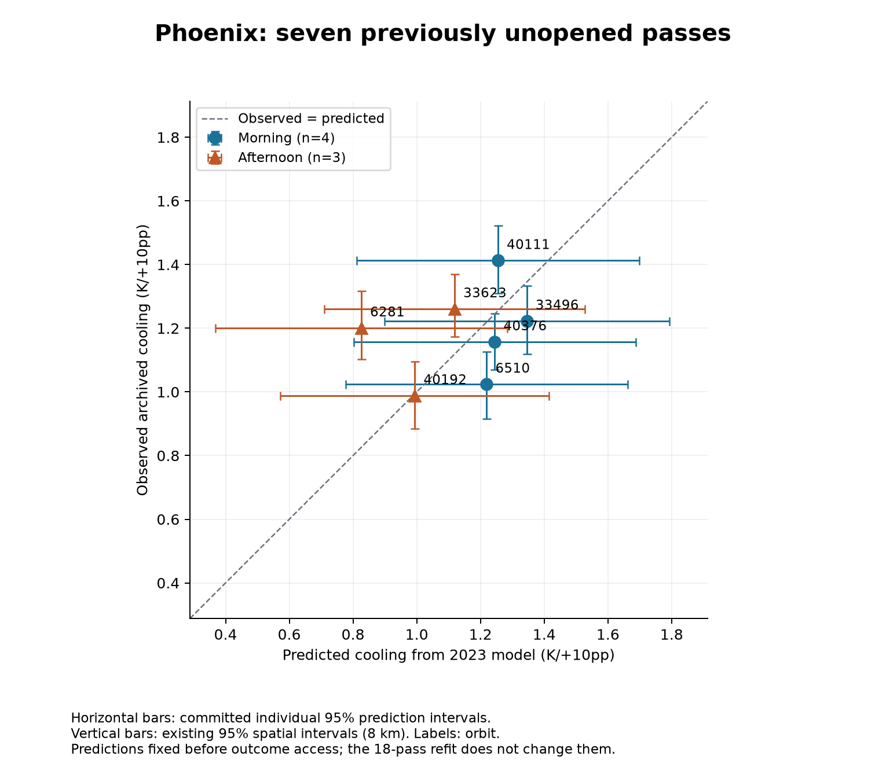

# Reza’s Figure 1 and our Steps 2–3 figures

[Back to the short review summary](README.md).

## Reference — Figure 1 from Reza’s review

Reproduced unchanged from **M. Reza Alizadeh’s _CanopyCooling Pilot Review and Next Steps_**. This is the original figure mentioned in his email, rather than a new Step 2 fit.

**Original caption:** Figure 1. Canopy-associated cooling for each 2023 pass against sun elevation at acquisition. Bars are the existing 8 km spatial intervals; the dashed curve is a fit proportional to the sine of sun elevation. Late-afternoon passes are labelled with apparent solar time.

[Open/download original-resolution PNG](reference/reza_review_figure_1.png) · [Source and checksum record](../../../docs/v2/v6_2/execution/advisor_figure1_publication_20261027/source_record.json).

## Step 2 — Phoenix

Original-population and common-footprint results use the same eleven 2023 dates. Circles are morning; triangles are afternoon. Bars are existing 95% spatial intervals using 8 km groups. Lines are the requested unweighted shortwave-plus-after_noon models; they are drawn only across each arm’s observed radiation range. Positive after-noon point estimates have intervals that include zero.

[PDF](../../../deliverables/Advisor_Step2_Models_2023_v6_2_20261026/phoenix_shortwave.pdf) · [Sun-elevation repeat](../../../deliverables/Advisor_Step2_Models_2023_v6_2_20261026/phoenix_sun_elevation.png) · [Coefficient table](../../../deliverables/Advisor_Step2_Models_2023_v6_2_20261026/coefficients.csv).

## Step 2 — Atlanta

The adjusted after-noon estimate is close to zero, but this is descriptive: five dates, two residual degrees of freedom and no morning/afternoon radiation-range overlap. Spatial error bars are not regression weights or regression confidence intervals.

[PDF](../../../deliverables/Advisor_Step2_Models_2023_v6_2_20261026/atlanta_shortwave.pdf) · [Sun-elevation repeat](../../../deliverables/Advisor_Step2_Models_2023_v6_2_20261026/atlanta_sun_elevation.png).

## Step 3 — Seven previously unopened Phoenix estimates

Predictions were committed before outcome access. All seven observed points fall within their individual prediction intervals; the largest miss is orbit 6281. Horizontal bars are prediction intervals; vertical bars are existing observed-pass spatial intervals. The later eighteen-pass refit does not change these predictions.

[PDF](../../../deliverables/Advisor_Step3_Prediction_Test_v6_2_20261026/observed_vs_predicted.pdf) · [Exact observed/predicted values](../../../deliverables/Advisor_Step3_Prediction_Test_v6_2_20261026/observed_vs_predicted_7.csv) · [Pre-access prediction note](../../../deliverables/Advisor_Step3_Prediction_Test_v6_2_20261026/pre_access/prediction_note_20261026.md).
